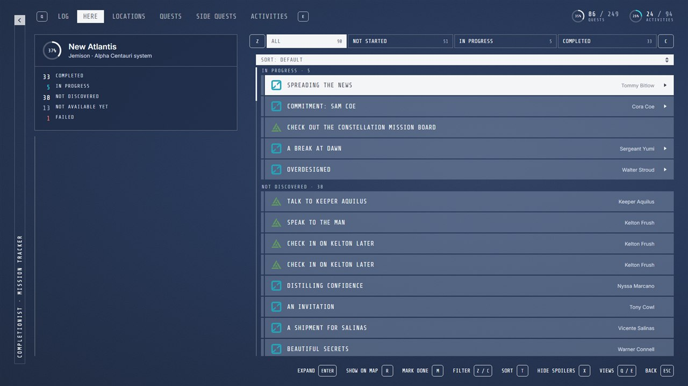

# Completionist for Starfield

**Completionist - Quest and Activity Tracker**

[](https://www.nexusmods.com/starfield/mods/18434)
[](LICENSE)
[](#install)

**See exactly which quests you're still missing in every system, planet and city**, in a menu that looks like it's part of the game. Inspired by Faen90's [Completionist](https://www.nexusmods.com/skyrimspecialedition/mods/46358) for Skyrim.

**[Download on Nexus Mods](https://www.nexusmods.com/starfield/mods/18434)** · PC (Steam) · version 1.0.1



## Features

- **What you're missing, where you are.** Open it anywhere: it shows how much of that city, planet or system you've completed, what's still undiscovered there and what you're in the middle of.
- **Every quest, activity and errand**, DLCs included, by place and by questline, each with its own completion %.
- **Not available yet:** quests the story hasn't unlocked, and what unlocks them ("Unlocks during Unity"), so you know not to look for them yet.
- **Objectives:** open a quest to see what's left to do, then track it or set a course to an objective, straight from the menu.
- **Built-in look:** layout, fonts, colors, faction icons and controls follow the game's own Missions menu.
- **Spoiler mode:** hides the names of quests and places you haven't found yet.
- **Branching choices and New Game+ handled**, so 100% is always reachable. Manual "mark done" for when detection gets one wrong.
- **Full controller support.**

## Install

Requires [SFSE](https://www.nexusmods.com/starfield/mods/106), [OSF UI](https://www.nexusmods.com/starfield/mods/17711) 2.0+ and OSF Settings 1.1+. Install [from Nexus Mods](https://www.nexusmods.com/starfield/mods/18434) with Vortex or Mod Organizer 2, enable `StarfieldCompletionist.esm`, and start the game through SFSE. The same zip is also on the [GitHub releases page](https://github.com/rixbrnn/starfield-completionist/releases/latest) if Nexus doesn't work for you.

**Open the menu** with **F7** (change it in **Pause menu > Mod Settings > Keybindings**). With a controller, assign a binding there to **Open Completionist**; we recommend **X + A** pressed together. There is no controller binding by default.

**In the menu:** **LB / RB** (Q / E) switch views, a **right-stick flick** (Z / C) switches the category tabs, **A** (Enter) opens a quest and, on an objective, tracks it, **X** (R) shows it on the map, **Y** (T) sorts.

## Contributing

Found a quest tracked wrongly, or a bug? [Open an issue](https://github.com/rixbrnn/starfield-completionist/issues/new/choose). Most fixes are quest data and need no coding: see [CONTRIBUTING.md](CONTRIBUTING.md).

## Building from source

You need Node.js 24+ (it runs the TypeScript tools directly), a Steam install of Starfield, and the **Starfield Creation Kit** (free on Steam) for its Papyrus compiler and the base game's script sources.

```bash
npm install
npm run extract:quests   # dump every quest record from the game files
npm run build:drafts     # regenerate data/quests/*.json from it and data/curation.json
npm run build:mod        # compile scripts, generate the plugin and the menu into build/mod
npm run package          # dist/StarfieldCompletionist-<version>.zip, the release zip
```

Other commands:

- `npm run build:mod -- --install` also copies the build into your game and activates the plugin.
- `npm run preview:menu` serves the menu at http://localhost:5173 with sample progress (`?here=<place>`, `?showcase=1`, and more options in `ui/menu/app.js`).
- `npm run media` captures the Nexus banner and screenshots into `dist/nexus-media/`.
- `npm run validate` checks the quest data against the schema; `npm run typecheck` type-checks the tools.

The game path is found automatically for default Steam installs; otherwise pass `--game <path>` or set `STARFIELD_PATH`. Nothing taken from the game is committed: the base scripts, quest dump, name table and faction icons are extracted into `build/` from your own install.

## Repository layout

| Path | What |
|---|---|
| `papyrus/Source/Completionist/` | Papyrus scripts: the quest tracker and the bridge to the menu |
| `ui/menu/` | The menu (HTML/CSS/JS, an [OSF UI](https://www.nexusmods.com/starfield/mods/17711) view) |
| `settings/` | OSF Settings schema (the F7 hotkey) |
| `data/quests/`, `data/curation.json` | Quest data per plugin, and the hand-made corrections to it |
| `data/schema/` | JSON Schema for the quest data |
| `tools/extract/` | Extract quests, objectives, places, unlocks and icons from the game files |
| `tools/build/` | Build the plugin, scripts and menu; package the release |
| `tools/esm/` | Readers for Starfield plugin files, BA2 archives, string tables and SWF |
| `tools/media/` | Nexus banner and screenshot capture |
| `docs/` | Nexus description, research notes, quest review list |
| `plugin/`, `xmake.lua`, `lib/` | Early native SFSE plugin experiment (not used by the mod) |

## License

[GPL-3.0-or-later](LICENSE) with the modding and linking exceptions in [EXCEPTIONS](EXCEPTIONS). The bundled fonts, Share Tech Mono and Inter, are under the SIL Open Font License ([ui/menu/fonts/OFL.txt](ui/menu/fonts/OFL.txt)). Starfield and its faction icons belong to Bethesda Softworks.
